重庆邮电大学 2027年研究生报考指南

工业和信息化部重庆市人民政府共建高校

全国毕业生就业典型经验高校

国家“中西部高等教育振兴计划”支持高校

全国首批深化创新创业教育改革示范高校

教育部“卓越工程师教育培养计划”实施高校

国家工程硕博士培养改革专项试点高校

全国创新创业典型经验高校

国家技术发明奖、国家科技进步奖、国家教学成果奖

全国绿化模范单位

全国科学大会奖、中国高校十大科技进展成果获得单位

全国文明校园

博士学位授予单位

全国文明单位

国家高技术产业化示范工程基地

全国国防教育特色学校

全国信息产业科技创新先进集体

全国高校教师考核评价改革示范校

全国大学生文化素质教育基地

教育部华为“智能基座”产教融合协同育人基地

## 重庆市一流/重点学科

<table><tr><td>序号</td><td>学科代码</td><td>学科名称</td><td>类别</td><td>批准部门</td></tr><tr><td>1</td><td>0810</td><td>信息与通信工程</td><td rowspan="2">重庆市一流学科</td><td rowspan="16">重庆市教育委员会</td></tr><tr><td>2</td><td>0812</td><td>计算机科学与技术</td></tr><tr><td>3</td><td>0301</td><td>法学</td><td rowspan="14">重庆市重点学科</td></tr><tr><td>4</td><td>0305</td><td>马克思主义理论</td></tr><tr><td>5</td><td>0701</td><td>数学</td></tr><tr><td>6</td><td>0702</td><td>物理学</td></tr><tr><td>7</td><td>0711</td><td>系统科学</td></tr><tr><td>8</td><td>0804</td><td>仪器科学与技术</td></tr><tr><td>9</td><td>0809</td><td>电子科学与技术</td></tr><tr><td>10</td><td>0811</td><td>控制科学与工程</td></tr><tr><td>11</td><td>0831</td><td>生物医学工程</td></tr><tr><td>12</td><td>0839</td><td>网络空间安全</td></tr><tr><td>13</td><td>1201</td><td>管理科学与工程</td></tr><tr><td>14</td><td>0551</td><td>翻译</td></tr><tr><td>15</td><td>1351</td><td>艺术</td></tr><tr><td>16</td><td>1401</td><td>集成电路科学与工程</td></tr></table>

学校共有计算机科学、工程学、材料科学、化学、地球科学5 个学科进入ESI国际学科排名前1%。其中，计算机科学、工程学学科分别进入 ESI全球前1.016‰、1.239‰。

学校共有通信工程、计算机科学与工程、交通运输工程、遥感技术、仪器科学、人工智能、电力电子工程、控制科学与工程、数学等9个学科上榜2025软科“世界一流学科排名”。其中，通信工程、计算机科学与工程、交通运输工程、遥感技术、仪器科学5 个学科进入全球前100。

学校共有智能科学与技术、信息与通信工程、计算机科学与技术、网络空间安全学科等13个学科上榜2025软科“中国最好学科排名”。其中，智能科学与技术首次上榜，位于前30%，全国排名第 18；信息与通信工程位于前12%，全国排名第20；计算机科学与技术位于前 12%，全国排名第31。

# 重庆邮电大学概况

重庆邮电大学是国家布点设立并重点建设的邮电高校之一，是工业和信息化部与重庆市共建的一所特色鲜明、优势突出，在信息通信领域具有重要影响的高水平大学。学校发轫于1950年，在抗战时期交通部邮政总局原址上开办邮政人员培训班；在此基础上，先后举办西南邮电分校、重庆邮电学校和重庆电信学校；1959 年国务院正式批准成立重庆邮电学院，并开始本科教育；1965年成为当时四川省招收硕士研究生的10所院校之一；1970 年改建为电信总局529 厂，1973年改建为邮电部第九研究所，1980 年恢复办学。2000年由原信产部划转重庆市管理，实行部市共建；2006 年更名为重庆邮电大学；2013年批准为博士学位授予单位。

学校现有在校学生3.2 万人，其中研究生8300 余人。在职教职工2100余人，其中高级职称 900 余人，博士生导师和硕士生导师 1200余人。学校校友、中国工程院原副院长邬贺铨院士为名誉校长。学校聘任了中国科学院、中国工程院和英国、加拿大、美国、波兰、印度等国 50 余名知名专家学者为兼职教授或名誉教授。学校有国家级和省部级人才180余人，全国五一劳动奖章、全国师德标兵、全国模范教师、全国优秀教师、重庆市名师等国家和省部级荣誉获得者160余人，有全国黄大年式教师团队3个，国家级教学团队和虚拟教研室6个、市级教学团队/基层教学组织 44支，博士后科研流动站2个、博士后科研工作站10 个。

学校为全国大学生文化素质教育基地、全国首批信息专业人才培训基地、全国首批通信科普教育基地、重庆市高水平新工科高校、重庆市软件人才和微电子人才培养基地、重庆市研究生教育创新基地。学校现有学院17 个，重庆市一流学科 2个、重庆市重点学科16个、重庆市“人工智能+”学科群建设项目5个，一级学科博士学位授权点4个、专业学位类别博士学位授权点1 个、一级学科硕士学位授权点21个、专业硕士学位类别及专业领域28 个，经教育部批准具有推荐本科生免试攻读研究生资格。学校工程学、计算机科学、材料科学、化学、地球科学 5个学科进入ESI国际排名前1%。

学校是国家工程硕博士培养改革专项试点高校、重庆市高水平新工科高校、重庆市卓越工程师学院试点高校，现建有国家级实验教学示范中心 1个、国家级虚拟仿真实验教学中心1个、国家级工程实践教育基地/中心11个、市级实验教学示范中心8个、重庆市产教融合虚实一体化实践教学平台1 个、校外实习实训和就业基地300余个；工业互联网学院入选国家首批现代产业学院，另有工信部“智能汽车专精特新产业学院”和重庆市未来技术学院 1个、现代产业学院 4个、特色化示范性软件学院1个、基础学科拔尖人才培养示范基地1个、创新创业学院1个。毕业生就业率保持在90%以上，获评全国首批深化创新创业教育改革示范高校、全国创新创业典型经验高校和全国毕业生就业典型经验高校。学校为信息通信行业和地方培养输送了 17 万余名各类人才，被誉为“中国信息通信人才的摇篮”。

学校是全国信息产业科技创新先进集体和国家高技术产业化示范工程基地，被誉为“中国数字通信发祥地”。学校现建有移动通信终端与网络控制国家地方联合工程研究中心（重庆）、中国－韩国工业物联网“一带一路”联合实验室、重庆工业物联网示范性国际科技合作基地、网络空间大数据智能安全教育部重点实验室、量子信息智能网络基础理论与技术学科创新引智基地、旅游多源数据感知与决策技术文化和旅游部重点实验室、数字经济智能与安全川渝共建实验室等 91个国家发展改革委、科技部、教育部、文旅部及重庆市重点实验室、工程研究中心和人文社科科研平台。“多粒度认知计算理论及应用创新研究群体”入选国家自然科学基金委员会创新研究群体，“新一代信息网络与终端协同创新中心”入选教育部省部共建协同创新中心，“工业物联网协同创新中心”“大数据协同创新中心”入选重庆市“2011 协同创新中心”择优支持计划，“移动信息终端与测试技术”等20 余个团队获批国家级、省部级创新群体/团队。学校在通信网及测试技术、新一代宽带无线移动通信、计算机网络与信息安全、智能信息处理、物联网与智能控制、先进制造与信息化技术、微电子技术与专用芯片设计等领域，承担了一大批重大科研项目。学校曾先后成功研制第一套符合国际电联标准的24路、30/32路脉冲编码机和120路复接设备及其配套仪表，参与制定第三代移动通信标准并设计出世界上第一颗 TD—SCDMA 基带芯片，制定了我国工业自动化领域第一个拥有自主知识产权的 EPA国际标准，研制出我国安全领域信息隔离与交换关键设备，研发出全球首款支持三大工业无线国际标准的工业物联网核心芯片，提出了不确定性知识的多粒度发现模型与方法。近年来，学校承担了包括国家科技重大专项、973 项目、863项目、国家重点研发计划专项、国家创新群体项目、国家杰出青年基金项目、国家自然科学基金重点项目、国家社会科学基金重大重点项目等国家级项目 670余项，承担省部级项目 1700余项，获得省部级以上奖励171项，其中包括国家级奖励5项，省部级一等奖39项；获授权发明专利5000余项。学校英文期刊 Digital Communications and Networks（DCN）荣获“中国最具国际影响力学术期刊”称号，位列JCRQ1 区。

学校与中国电信、中国联通、中国移动、中国电科、中国广电、中国星网、中国邮政、中国铁塔、华为、中兴、腾讯等行业知名企业，与中国科学院、中国社科院、中国信通院等科研院所，与赛力斯、长安汽车、四联集团、国网重庆电力等在渝大型企业建立了紧密合作关系。学校以高质量打造国家级大学科技园为牵引，主动融入西部（重庆）科学城、两江协同创新区、仙桃数据谷等建设，密切与地方政府、园区和重点企业合作，全面加强“大数据智能化产业技术协同创新研究院”“空间通信研究院”“工业互联网研究院/工业互联网学院”“重庆市集成电路协同创新中心·重庆集成电路学院”“国家级众创空间”“教育部—中兴通讯ICT 产教融合创新基地”“华为优秀创新人才中心”“鲲鹏创新学院”“华为优秀创新人才中心”“国家级专业技术人员继续教育基地”“全国高校毕业生就业能力培训基地”等100余个产教融合平台建设，创新人才培养模式和机制。

学校深入推动高水平教育对外开放，主动服务国家对外开放战略，积极落实共建“一带一路”教育行动，有序开拓全方位、宽领域、多层次的教育国际合作交流新局面。目前，已与美国、英国、俄罗斯、新加坡、日本、韩国、泰国等国家及港澳台地区 100 余所高校和科研机构建立合作伙伴关系，开展联合人才培养、师生双向交流、联合科学研究、海外实践研修等各类国际学术交流项目，加快推进构建国际化人才培养体系，打造高水平国际化师资队伍，促进师生参与国际学术交流。高质量实施与美国、英国高校合作举办的 3 个中外合作办学项目、与俄罗斯高校联合举办的 1 个中外合作办学机构，办学成效日益凸显。与俄罗斯、法国和泰国合作院校开展境外办学项目。学校自1999 年起招收来华留学生，是中国政府奖学金以及重庆市人民政府外国留学生市长奖学金项目高校，连续两轮顺利通过国家来华留学质量认证。

新征程已经开启，新蓝图催人奋进。学校将高举中国特色社会主义伟大旗帜，坚持以习近平新时代中国特色社会主义思想为指导，全面学习贯彻落实党的二十大及二十届历次全会精神，全面贯彻党的教育方针，全面落实立德树人根本任务，按照学校第四次党代会确定的目标任务，秉承“修德、博学、求实、创新”的重邮校训，弘扬“敢为人先、百折不挠、团结奋斗、乐于奉献”的重邮精神，传承“志不求易、事不避难”的重邮校风，赓续“通信报国”的红色基因、“敢为人先”的创新基因、“舍我其谁”的奉献基因，践行“严谨 严肃”的教风和“求真 求正”的学风，以砥砺实施学校“世界一流学科攀登计划”为主线，以高质量内涵式发展为主题，以改革开放创新为根本动力，以办好人民满意的教育为根本目的，以“为党育人、为国育才”为办学使命，以服务国家战略需求和地方经济社会发展需要为办学担当，恪守“唯实惟先、日新日进”的质量文化，凝心聚力、勇攀高峰，努力培养大批信念坚定、志存高远、德智体美劳全面发展，具有扎实专业知识、持续发展能力、执着行业情怀的高素质创新型人才，为全面建设特色鲜明高水平大学而团结奋斗，努力在新时代新征程赢得属于全体重邮人更大的胜利和荣光，为全面建设社会主义现代化国家、全面推进中华民族伟大复兴作出重邮新的更大贡献！

## 欢迎有志青年报考重庆邮电大学研究生！

欢迎获得推荐免试资格的应届本科生申请我校推免生和直博生！

# 研究生人才培养体系

坚持分类施策，推行个性化培养。坚持以真实任务牵引培养过程、以分类标准落实培养要求、以能力达成和成果产出检验培养质量，构建学术拔尖、工程卓越、交叉复合的人才培养体系。学术拔尖聚焦基础理论、前沿问题和原始创新训练，突出学术成果与创新潜力；工程卓越聚焦产业贡献、工程实践和项目制工学交替，把实践成果产出作为核心评价标尺；交叉复合聚焦跨学科课程、AI+场景和联合导师团队，突出跨域融合与复杂问题解决能力。结合学生基础与发展方向制定个性化培养计划，对国家工程硕博士、教育部重庆高研院等专项研究生等实行“一生一策、一专项一方案”定制培养，结合个人科研兴趣、职业发展目标定制学习与实践规划，专人跟进学习进度，精准匹配导师、项目与实践资源，因材施教适配每位学生的发展方向。

优化课程体系，深化教学改革。以知识图谱为牵引打造精准匹配学科建设、科技创新和产业发展需求的特色课程体系，学术学位聚焦学科前沿交叉方向，专业学位联合行业龙头企业共同开发校企共建课程。推行项目式、案例式、研讨式课堂教学，弱化单一期末考核，侧重实践探究、项目实操等过程学习，实现知识内化。立足学校信息学科核心优势，全面布局“人工智能+”交叉课程集群，紧跟数智化发展趋势，让研究生在校掌握行业紧缺核心技术，就业竞争力大幅提升。

深化产教融汇，强化协同育人。学校与国科大重庆学院、电子科技大学、北大碳基研究院等开展联合培养育人工作。依托江南分院、现代产业学院等，携手长安、华润等龙头企业和西部科学城（重庆）、西永微电子园、仙桃大数据谷等产业园区共建研究生联合培养基地，拓展实践育人平台。搭建企业真题、工程案例、揭榜课题和创新创业资源库，推动产业需求、实战任务深度融入培养全过程。落实专业实践要求，推行校内外双导师制，邀请行业专家参与授课、项目指导、论文把关，学生在校即可深度参与企业真实横向科研项目，积累产业项目经验，适配优质企业就业需求。

丰富育人载体，促进全面发展。以能力图谱牵引创新创业能力培养，搭建丰富的创新实践成长载体，将高水平学科竞赛、创新创业项目、行业职业技能认证等纳入培养体系，竞赛获奖、创新成果可按规定置换课程学分。各类科研平台、科创赛事、创新创业孵化平台常态化开放，配套专业指导老师，充分释放学生创新潜力。校院两级常态化开展学术沙龙、行业前沿讲座、求职分享会、科研经验交流会，搭建师生交流、同辈互助的成长社群，从科研攻关、学业提升到就业规划、职业发展提供全方位引导，完善学位论文全流程指导服务，全程陪伴学生稳步完成科研学习，全面提升综合竞争力，升学、就业双向发展皆具备充足优势。

拓展国际交流，拓宽育人视野。依托国际化发展布局，学校与俄罗斯等多国及港澳台地区高校建立合作关系，打造信息特色鲜明的国际合作办学品牌，建设全英文授课专业与国际化特色课程，面向研究生推出丰富成长项目，涵盖中外联合培养、短期海外访学、国际学科竞赛、国际组织实习等多元渠道。设立研究生境外交流项目，通过后期资助形式提供经费支持，鼓励学生参加国际学术会议、开展联合科研，提升国际化科研素养，为未来深造、跨国企业就业增添核心优势。

2027 年研究生招生学科/专业领域

<table><tr><td>招生学院及代码</td><td>学科/专业领域名称及代码</td><td>学位类别</td><td>学习形式</td><td>招生层次</td></tr><tr><td rowspan="3">001通信与信息工程学院</td><td>081000 信息与通信工程</td><td>学术学位</td><td>全日制</td><td>博士/硕士</td></tr><tr><td>085401 新一代电子信息技术(含量子技术等)</td><td>专业学位</td><td>全日制</td><td>硕士</td></tr><tr><td>085402 通信工程(含宽带网络、移动通信等)</td><td>专业学位</td><td>全日制</td><td>博士/硕士</td></tr><tr><td rowspan="4">002计算机科学与技术学院</td><td>081200 计算机科学与技术</td><td>学术学位</td><td>全日制</td><td>博士/硕士</td></tr><tr><td>083500 软件工程</td><td>学术学位</td><td>全日制</td><td>硕士</td></tr><tr><td>085404 计算机技术</td><td>专业学位</td><td>全日制</td><td>博士/硕士</td></tr><tr><td>085405 软件工程</td><td>专业学位</td><td>全日制</td><td>硕士</td></tr><tr><td rowspan="3">003人工智能学院</td><td>140500 智能科学与技术</td><td>学术学位</td><td>全日制</td><td>博士/硕士</td></tr><tr><td>085410 人工智能</td><td>专业学位</td><td>全日制</td><td>博士/硕士</td></tr><tr><td>085411 大数据技术与工程</td><td>专业学位</td><td>全日制</td><td>硕士</td></tr><tr><td rowspan="8">004自动化学院</td><td>081100 控制科学与工程</td><td>学术学位</td><td>全日制</td><td>硕士</td></tr><tr><td>080400 仪器科学与技术</td><td>学术学位</td><td>全日制</td><td>硕士</td></tr><tr><td>080800 电气工程</td><td>学术学位</td><td>全日制</td><td>硕士</td></tr><tr><td>1405J1 低空技术与工程</td><td>学术学位</td><td>全日制</td><td>博士/硕士</td></tr><tr><td>085406 控制工程</td><td>专业学位</td><td>全日制</td><td>博士/硕士</td></tr><tr><td>085407 仪器仪表工程</td><td>专业学位</td><td>全日制</td><td>硕士</td></tr><tr><td>085800 能源动力</td><td>专业学位</td><td>全日制</td><td>硕士</td></tr><tr><td>086102 道路交通运输</td><td>专业学位</td><td>全日制</td><td>硕士</td></tr><tr><td rowspan="5">005电子科学与工程学院</td><td>070200 物理学</td><td>学术学位</td><td>全日制</td><td>硕士</td></tr><tr><td>080900 电子科学与技术</td><td>学术学位</td><td>全日制</td><td>硕士</td></tr><tr><td>080300 光学工程</td><td>学术学位</td><td>全日制</td><td>硕士</td></tr><tr><td>140600 纳米科学与工程</td><td>学术学位</td><td>全日制</td><td>硕士</td></tr><tr><td>085408 光电信息工程</td><td>专业学位</td><td>全日制</td><td>博士/硕士</td></tr><tr><td rowspan="4">006集成电路学院</td><td>080200 机械工程</td><td>学术学位</td><td>全日制</td><td>硕士</td></tr><tr><td>140100 集成电路科学与工程</td><td>学术学位</td><td>全日制</td><td>硕士</td></tr><tr><td>085403 集成电路工程</td><td>专业学位</td><td>全日制</td><td>博士/硕士</td></tr><tr><td>085500 机械</td><td>专业学位</td><td>全日制</td><td>硕士</td></tr><tr><td rowspan="3">007生命健康信息科学与工程学院</td><td>071000 生物学</td><td>学术学位</td><td>全日制</td><td>硕士</td></tr><tr><td>083100 生物医学工程</td><td>学术学位</td><td>全日制</td><td>硕士</td></tr><tr><td>085409 生物医学工程</td><td>专业学位</td><td>全日制</td><td>博士/硕士</td></tr><tr><td rowspan="3">008网络空间安全与信息法学院</td><td>030100 法学</td><td>学术学位</td><td>全日制</td><td>硕士</td></tr><tr><td>083900 网络空间安全</td><td>学术学位</td><td>全日制</td><td>硕士</td></tr><tr><td>085412 网络与信息安全</td><td>专业学位</td><td>全日制</td><td>博士/硕士</td></tr></table>

④2027年125604物流工程与管理专业仅招收全日制定向考生。

<table><tr><td>招生学院及代码</td><td>学科/专业领域名称及代码</td><td>学位类别</td><td>学习形式</td><td>招生层次</td></tr><tr><td rowspan="3">009数学与统计学院</td><td>070100 数学</td><td>学术学位</td><td>全日制</td><td>硕士</td></tr><tr><td>071100 系统科学</td><td>学术学位</td><td>全日制</td><td>硕士</td></tr><tr><td>025200 应用统计</td><td>专业学位</td><td>全日制</td><td>硕士</td></tr><tr><td rowspan="5">011经济管理学院</td><td>120100 管理科学与工程</td><td>学术学位</td><td>全日制</td><td>博士/硕士</td></tr><tr><td>025800 数字经济</td><td>专业学位</td><td>全日制</td><td>硕士</td></tr><tr><td>125300 会计</td><td>专业学位</td><td>全日制</td><td>硕士</td></tr><tr><td>125100 工商管理</td><td>专业学位</td><td>非全日制</td><td>硕士</td></tr><tr><td>125601 工程管理</td><td>专业学位</td><td>非全日制</td><td>硕士</td></tr><tr><td rowspan="2">012现代邮政学院</td><td>125602 项目管理</td><td>专业学位</td><td>非全日制</td><td>硕士</td></tr><tr><td>125604 物流工程与管理</td><td>专业学位</td><td>全日制</td><td>硕士</td></tr><tr><td rowspan="2">013传媒艺术学院</td><td>135400 戏剧与影视</td><td>专业学位</td><td>全日制</td><td>硕士</td></tr><tr><td>135700 设计</td><td>专业学位</td><td>全日制</td><td>硕士</td></tr><tr><td>014外国语学院</td><td>055100 翻译</td><td>专业学位</td><td>全日制</td><td>硕士</td></tr><tr><td>015马克思主义学院</td><td>030500 马克思主义理论</td><td>学术学位</td><td>全日制</td><td>硕士</td></tr><tr><td rowspan="2">016体育学院</td><td>045201 体育教学</td><td>专业学位</td><td>全日制</td><td>硕士</td></tr><tr><td>045202 运动训练</td><td>专业学位</td><td>全日制</td><td>硕士</td></tr><tr><td rowspan="3">017重庆邮电大学远东联邦大学联合学院</td><td>081000 信息与通信工程(中外合作办学)</td><td>学术学位</td><td>全日制</td><td>硕士</td></tr><tr><td>081200 计算机科学与技术(中外合作办学)</td><td>学术学位</td><td>全日制</td><td>硕士</td></tr><tr><td>081100 控制科学与工程(中外合作办学)</td><td>学术学位</td><td>全日制</td><td>硕士</td></tr></table>

说明：①2026 年 9月，登录重庆邮电大学研究生院网站（网址：http://yjs.cqupt.edu.cn/ ）可以查  
阅《重庆邮电大学 2027年研究生招生章程》，了解各专业考试科目和研究生招生相关信息。  
②本指南中各专业2026年招生人数仅供参考。实际招生人数，以国家下达学校2027年研究生招生计划后学校研究生院官网公布的2027年硕士研究生分专业招生计划为准。我校保留根据生源情况、办学条件和考试情况对各专业招生计划进行适当调整的权利。  
③各招生学院工程类（08开头）专业硕士招生计划数包含卓越工程师等专项招生计划数。

近 3 年博士研究生各学科招生人数统计表

<table><tr><td>招生学院及代码</td><td>学科名称及代码</td><td>学位类别</td><td>2026年</td><td>2025年</td><td>2024年</td></tr><tr><td rowspan="2">001通信与信息工程学院</td><td>081000信息与通信工程</td><td>学术学位</td><td>45</td><td>51</td><td>47</td></tr><tr><td>085402通信工程(含宽带网络、移动通信等)</td><td>专业学位</td><td>11</td><td>12</td><td></td></tr><tr><td rowspan="3">002计算机科学与技术学院</td><td>081200计算机科学与技术</td><td>学术学位</td><td>66</td><td>66</td><td>66</td></tr><tr><td>085404计算机技术</td><td>专业学位</td><td>6</td><td>10</td><td></td></tr><tr><td>085405软件工程</td><td>专业学位</td><td></td><td>7</td><td></td></tr><tr><td rowspan="2">003人工智能学院</td><td>140500智能科学与技术</td><td>学术学位</td><td>34</td><td>9</td><td></td></tr><tr><td>085410人工智能</td><td>专业学位</td><td>4</td><td></td><td></td></tr><tr><td rowspan="2">004自动化学院</td><td>1405J1低空技术与工程</td><td>学术学位</td><td>11</td><td></td><td></td></tr><tr><td>085406控制工程</td><td>专业学位</td><td>9</td><td>19</td><td></td></tr><tr><td>005电子科学与工程学院</td><td>085408光电信息工程</td><td>专业学位</td><td>5</td><td></td><td></td></tr><tr><td>006集成电路学院</td><td>085403集成电路工程</td><td>专业学位</td><td>18</td><td>12</td><td></td></tr><tr><td>007生命健康信息科学与工程学院</td><td>085409生物医学工程</td><td>专业学位</td><td>3</td><td>7</td><td></td></tr><tr><td>008网络空间安全与信息法学院</td><td>085412网络与信息安全</td><td>专业学位</td><td>4</td><td>5</td><td></td></tr><tr><td>011经济管理学院</td><td>120100管理科学与工程</td><td>学术学位</td><td>15</td><td>10</td><td></td></tr><tr><td colspan="3">合计</td><td>231</td><td>208</td><td>113</td></tr></table>

近 3 年硕士研究生各学科/专业领域招生人数统计表

<table><tr><td rowspan="2">招生学院及代码</td><td rowspan="2">学科/专业领域名称及代码</td><td rowspan="2">学位类别</td><td colspan="2">2026年</td><td colspan="2">2025年</td><td colspan="2">2024年</td></tr><tr><td>录取数</td><td>含推免</td><td>录取数</td><td>含推免</td><td>录取数</td><td>含推免</td></tr><tr><td rowspan="3">001 通信与信息工程学院</td><td>081000 信息与通信工程</td><td>学术学位</td><td>229</td><td>11</td><td>234</td><td>3</td><td>230</td><td>4</td></tr><tr><td>085401 新一代电子信息技术(含量子技术等)</td><td>专业学位</td><td rowspan="2">419</td><td></td><td rowspan="2">416</td><td>1</td><td rowspan="2">394</td><td></td></tr><tr><td>085402 通信工程(含宽带网络、移动通信等)</td><td>专业学位</td><td>9</td><td>3</td><td></td></tr><tr><td rowspan="4">002 计算机科学与技术学院</td><td>081200 计算机科学与技术</td><td>学术学位</td><td>123</td><td>5</td><td>175</td><td>3</td><td>173</td><td>4</td></tr><tr><td>083500 软件工程</td><td>学术学位</td><td>22</td><td>1</td><td>45</td><td>1</td><td>44</td><td></td></tr><tr><td>085404 计算机技术</td><td>专业学位</td><td>234</td><td>7</td><td>230</td><td></td><td>222</td><td>1</td></tr><tr><td>085405 软件工程</td><td>专业学位</td><td>108</td><td>3</td><td>119</td><td>3</td><td>93</td><td></td></tr><tr><td rowspan="3">003 人工智能学院</td><td>140500 智能科学与技术</td><td>学术学位</td><td>70</td><td>15</td><td></td><td></td><td></td><td></td></tr><tr><td>085410 人工智能</td><td>专业学位</td><td rowspan="2">163</td><td>23</td><td>50</td><td>7</td><td>35</td><td>1</td></tr><tr><td>085411 大数据技术与工程</td><td>专业学位</td><td>6</td><td>28</td><td></td><td>43</td><td>1</td></tr><tr><td rowspan="8">004 自动化学院</td><td>081100 控制科学与工程</td><td>学术学位</td><td>86</td><td>3</td><td>86</td><td>3</td><td>84</td><td>1</td></tr><tr><td>080400 仪器科学与技术</td><td>学术学位</td><td>19</td><td>1</td><td>19</td><td></td><td>13</td><td></td></tr><tr><td>080800 电气工程</td><td>学术学位</td><td>26</td><td>1</td><td>19</td><td></td><td>25</td><td>1</td></tr><tr><td>1405J1 低空技术与工程</td><td>学术学位</td><td colspan="6">2027年首次招生</td></tr><tr><td>085406 控制工程</td><td>专业学位</td><td>218</td><td>2</td><td>208</td><td>4</td><td>187</td><td></td></tr><tr><td>085407 仪器仪表工程</td><td>专业学位</td><td>17</td><td></td><td>27</td><td></td><td>17</td><td></td></tr><tr><td>085800 能源动力</td><td>专业学位</td><td>15</td><td></td><td>14</td><td></td><td>6</td><td></td></tr><tr><td>086102 道路交通运输</td><td>专业学位</td><td>13</td><td></td><td>13</td><td></td><td>28</td><td></td></tr><tr><td rowspan="4">005 电子科学与工程学院</td><td>070200 物理学</td><td>学术学位</td><td>19</td><td></td><td>25</td><td></td><td>23</td><td></td></tr><tr><td>080900 电子科学与技术</td><td>学术学位</td><td>65</td><td>1</td><td>53</td><td></td><td>60</td><td>1</td></tr><tr><td>080300 光学工程</td><td>学术学位</td><td>27</td><td></td><td>32</td><td></td><td>36</td><td></td></tr><tr><td>140600 纳米科学与工程085408 光电信息工程</td><td>学术学位专业学位</td><td>629</td><td></td><td>1015</td><td></td><td>15</td><td></td></tr><tr><td rowspan="4">006 集成电路学院</td><td>080200 机械工程</td><td>学术学位</td><td>17</td><td></td><td>19</td><td>1</td><td>18</td><td></td></tr><tr><td>140100 集成电路科学与工程</td><td>学术学位</td><td>7</td><td></td><td>5</td><td></td><td>10</td><td></td></tr><tr><td>085403 集成电路工程</td><td>专业学位</td><td>200</td><td>5</td><td>211</td><td>4</td><td>179</td><td></td></tr><tr><td>085500 机械</td><td>专业学位</td><td>50</td><td></td><td>57</td><td></td><td>38</td><td>1</td></tr><tr><td rowspan="3">007 生命健康信息科学与工程学院</td><td>071000 生物学</td><td>学术学位</td><td>19</td><td>1</td><td>23</td><td>2</td><td>21</td><td></td></tr><tr><td>083100 生物医学工程</td><td>学术学位</td><td>20</td><td></td><td>15</td><td></td><td>14</td><td>1</td></tr><tr><td>085409 生物医学工程</td><td>专业学位</td><td>33</td><td></td><td>36</td><td></td><td>28</td><td></td></tr><tr><td rowspan="5">008 网络空间安全与信息法学院</td><td>030100 法学</td><td>学术学位</td><td>27</td><td></td><td>32</td><td></td><td>22</td><td>1</td></tr><tr><td>083900 网络空间安全</td><td>学术学位</td><td>20</td><td>3</td><td>32</td><td></td><td>31</td><td>2</td></tr><tr><td>035101 法律(非法学)</td><td>专业学位</td><td>7</td><td></td><td></td><td></td><td></td><td></td></tr><tr><td>035102 法律(法学)</td><td>专业学位</td><td>0</td><td></td><td></td><td></td><td>12</td><td></td></tr><tr><td>085412 网络与信息安全</td><td>专业学位</td><td>58</td><td>2</td><td>40</td><td>3</td><td>34</td><td></td></tr><tr><td rowspan="3">009 数学与统计学院</td><td>070100 数学</td><td>学术学位</td><td>38</td><td>1</td><td>39</td><td></td><td>40</td><td>2</td></tr><tr><td>071100 系统科学</td><td>学术学位</td><td>8</td><td></td><td>9</td><td></td><td>10</td><td></td></tr><tr><td>025200 应用统计</td><td>专业学位</td><td>10</td><td></td><td>10</td><td></td><td></td><td></td></tr><tr><td rowspan="5">011 经济管理学院</td><td>120100 管理科学与工程</td><td>学术学位</td><td>70</td><td>8</td><td>69</td><td>7</td><td>62</td><td>4</td></tr><tr><td>025800 数字经济</td><td>专业学位</td><td>10</td><td>1</td><td>5</td><td></td><td></td><td></td></tr><tr><td>125300 会计</td><td>专业学位</td><td>14</td><td></td><td>15</td><td></td><td></td><td></td></tr><tr><td>125100 工商管理(非全日制)</td><td>专业学位</td><td>26</td><td></td><td>49</td><td></td><td>32</td><td></td></tr><tr><td>125601 工程管理(非全日制)</td><td>专业学位</td><td>12</td><td></td><td>20</td><td></td><td>10</td><td></td></tr><tr><td rowspan="3">012 现代邮政学院</td><td>125602 项目管理(非全日制)</td><td>专业学位</td><td>15</td><td></td><td>31</td><td></td><td>13</td><td></td></tr><tr><td>125603 工业工程与管理</td><td>专业学位</td><td>10</td><td></td><td>10</td><td></td><td>30</td><td></td></tr><tr><td>125604 物流工程与管理</td><td>专业学位</td><td>86</td><td>1</td><td>85</td><td></td><td>86</td><td>2</td></tr><tr><td rowspan="2">013 传媒艺术学院</td><td>135400 戏剧与影视</td><td>专业学位</td><td>38</td><td>6</td><td>37</td><td>3</td><td>35</td><td>3</td></tr><tr><td>135700 设计</td><td>专业学位</td><td>21</td><td>8</td><td>20</td><td>3</td><td>17</td><td>2</td></tr><tr><td>014 外国语学院</td><td>055100 翻译</td><td>专业学位</td><td>29</td><td>2</td><td>27</td><td></td><td>28</td><td>1</td></tr><tr><td>015 马克思主义学院</td><td>030500 马克思主义理论</td><td>学术学位</td><td>45</td><td></td><td>45</td><td></td><td>44</td><td></td></tr><tr><td rowspan="2">016 体育学院</td><td>045201 体育教学</td><td>专业学位</td><td>15</td><td></td><td>13</td><td></td><td>11</td><td></td></tr><tr><td>045202 运动训练</td><td>专业学位</td><td colspan="6">2027年首次招生</td></tr><tr><td rowspan="3">017 重庆邮电大学远东联邦大学联合学院</td><td>081000 信息与通信工程(中外合作办学)</td><td>学术学位</td><td>30</td><td></td><td></td><td></td><td></td><td></td></tr><tr><td>081200 计算机科学与技术(中外合作办学)</td><td>学术学位</td><td>30</td><td></td><td></td><td></td><td></td><td></td></tr><tr><td>081100 控制科学与工程(中外合作办学)</td><td>学术学位</td><td>30</td><td></td><td></td><td></td><td></td><td></td></tr><tr><td colspan="3">合计</td><td>2903</td><td>126</td><td>2772</td><td>51</td><td>2553</td><td>33</td></tr></table>

注：学科/专业领域名称后未标注“非全日制”的均为全日制招生学科/专业领域。

近 3年硕士研究生各学科/专业领域复试最低分数要求

<table><tr><td rowspan="2">招生学院及代码</td><td rowspan="2">学科/专业领域名称及代码</td><td rowspan="2">学位类别</td><td colspan="3">分数线:总分/单科100/单科&gt;100</td></tr><tr><td>2026年</td><td>2025年</td><td>2024年</td></tr><tr><td rowspan="3">001通信与信息工程学院</td><td>081000信息与通信工程</td><td>学术学位</td><td>270/35/53</td><td>280/34/51</td><td>317/37/56</td></tr><tr><td>085401新一代电子信息技术(含量子技术等)</td><td>专业学位</td><td rowspan="2">343/35/53</td><td rowspan="2">340/34/51</td><td rowspan="2">327/37/56</td></tr><tr><td>085402通信工程(含宽带网络、移动通信等)</td><td>专业学位</td></tr><tr><td rowspan="4">002计算机科学与技术学院</td><td>081200计算机科学与技术</td><td>学术学位</td><td>264/35/53</td><td>308/34/51</td><td>313/37/56</td></tr><tr><td>083500软件工程</td><td>学术学位</td><td>264/35/53</td><td>273/34/51</td><td>273/37/56</td></tr><tr><td>085404计算机技术</td><td>专业学位</td><td>330/35/53</td><td>292/34/51</td><td>295/37/56</td></tr><tr><td>085405软件工程</td><td>专业学位</td><td>345/35/53</td><td>270/34/51</td><td>273/37/56</td></tr><tr><td rowspan="3">003人工智能学院</td><td>140500智能科学与技术</td><td>学术学位</td><td>266/35/53</td><td></td><td></td></tr><tr><td>085410人工智能</td><td>专业学位</td><td>336/35/53</td><td>292/34/51</td><td>295/37/56</td></tr><tr><td>085411大数据技术与工程</td><td>专业学位</td><td>336/35/53</td><td>292/34/51</td><td>295/37/56</td></tr><tr><td rowspan="8">004自动化学院</td><td>081100控制科学与工程</td><td>学术学位</td><td>264/35/53</td><td>260/34/51</td><td>275/37/56</td></tr><tr><td>080400仪器科学与技术</td><td>学术学位</td><td>264/35/53</td><td>260/34/51</td><td>273/37/56</td></tr><tr><td>080800电气工程</td><td>学术学位</td><td>264/35/53</td><td>260/34/51</td><td>320/37/56</td></tr><tr><td>1405J1低空技术与工程</td><td>学术学位</td><td colspan="3">2027年首次招生</td></tr><tr><td>085406控制工程</td><td>专业学位</td><td>330/35/53</td><td>305/34/51</td><td>300/37/56</td></tr><tr><td>085407仪器仪表工程</td><td>专业学位</td><td>300/35/53</td><td>270/34/51</td><td>285/37/56</td></tr><tr><td>085800能源动力</td><td>专业学位</td><td>280/35/53</td><td>300/34/51</td><td>273/37/56</td></tr><tr><td>086102道路交通运输</td><td>专业学位</td><td>280/35/53</td><td>260/34/51</td><td>275/37/56</td></tr><tr><td rowspan="5">005电子科学与工程学院</td><td>070200物理学</td><td>学术学位</td><td>275/35/53</td><td>300/34/51</td><td>288/41/62</td></tr><tr><td>080900电子科学与技术</td><td>学术学位</td><td>264/35/53</td><td>260/34/51</td><td>273/37/56</td></tr><tr><td>080300光学工程</td><td>学术学位</td><td>264/35/53</td><td>260/34/51</td><td>273/37/56</td></tr><tr><td>140600纳米科学与工程</td><td>学术学位</td><td>266/35/53</td><td>266/34/51</td><td></td></tr><tr><td>085408光电信息工程</td><td>专业学位</td><td>264/35/53</td><td>260/34/51</td><td>273/37/56</td></tr><tr><td rowspan="4">006集成电路学院</td><td>080200机械工程</td><td>学术学位</td><td>264/35/53</td><td>274/34/51</td><td>278/37/56</td></tr><tr><td>140100集成电路科学与工程</td><td>学术学位</td><td>266/35/53</td><td>266/34/51</td><td>275/39/59</td></tr><tr><td>085403集成电路工程</td><td>专业学位</td><td>332/35/53</td><td>285/34/51</td><td>280/37/56</td></tr><tr><td>085500机械</td><td>专业学位</td><td>334/35/53</td><td>263/34/51</td><td>276/37/56</td></tr><tr><td rowspan="3">007生命健康信息科学与工程学院</td><td>071000生物学</td><td>学术学位</td><td>275/35/53</td><td>285/34/51</td><td>305/41/62</td></tr><tr><td>083100生物医学工程</td><td>学术学位</td><td>264/35/53</td><td>288/34/51</td><td>273/37/56</td></tr><tr><td>085409生物医学工程</td><td>专业学位</td><td>264/35/53</td><td>272/34/51</td><td>273/37/56</td></tr><tr><td rowspan="5">008网络空间安全与信息法学院</td><td>030100法学</td><td>学术学位</td><td>332/40/60</td><td>323/40/60</td><td>331/47/71</td></tr><tr><td>083900网络空间安全</td><td>学术学位</td><td>264/35/53</td><td>286/34/51</td><td>273/37/56</td></tr><tr><td>035101法律(非法学)</td><td>专业学位</td><td>321/40/60</td><td>323/40/60</td><td></td></tr><tr><td>035102法律(法学)</td><td>专业学位</td><td></td><td></td><td>331/47/71</td></tr><tr><td>085412网络与信息安全</td><td>专业学位</td><td>272/35/53</td><td>280/34/51</td><td>287/37/56</td></tr><tr><td rowspan="3">009数学与统计学院</td><td>070100数学</td><td>学术学位</td><td>275/35/53</td><td>290/34/51</td><td>288/41/62</td></tr><tr><td>071100系统科学</td><td>学术学位</td><td>275/35/53</td><td>280/34/51</td><td>288/41/62</td></tr><tr><td>025200应用统计</td><td>专业学位</td><td>330/40/60</td><td>330/40/60</td><td></td></tr><tr><td rowspan="3">011经济管理学院</td><td>120100管理科学与工程</td><td>学术学位</td><td>332/41/62</td><td>333/41/62</td><td>357/49/74</td></tr><tr><td>025800数字经济</td><td>专业学位</td><td>324/40/60</td><td>323/40/60</td><td></td></tr><tr><td>125300会计125100 工商管理(非全日制)</td><td>专业学位专业学位</td><td>212/51/102146/35/70</td><td>198/48/96151/35/70</td><td>162/39/78</td></tr><tr><td></td><td>125601 工程管理(非全日制)</td><td>专业学位</td><td>166/39/78</td><td>162/38/79</td><td>184/43/86</td></tr><tr><td rowspan="3">012 现代邮政学院</td><td>125602 项目管理(非全日制)</td><td>专业学位</td><td>166/39/78</td><td>162/38/79</td><td>176/43/86</td></tr><tr><td>125603 工业工程与管理</td><td>专业学位</td><td>203/39/78</td><td>183/38/76</td><td>206/43/86</td></tr><tr><td>125604 物流工程与管理</td><td>专业学位</td><td>207/39/78</td><td>203/38/76</td><td>211/43/86</td></tr><tr><td rowspan="2">013 传媒艺术学院</td><td>135400 戏剧与影视</td><td>专业学位</td><td>385/38/57</td><td>377/37/56</td><td>381/40/60</td></tr><tr><td>135700 设计</td><td>专业学位</td><td>380/38/57</td><td>351/37/56</td><td>373/40/60</td></tr><tr><td>014 外国语学院</td><td>055100 翻译</td><td>专业学位</td><td>369/48/72</td><td>351/47/71</td><td>365/55/83</td></tr><tr><td>015 马克思主义学院</td><td>030500 马克思主义理论</td><td>学术学位</td><td>321/40/60</td><td>356/40/60</td><td>362/47/71</td></tr><tr><td rowspan="2">016 体育学院</td><td>045201 体育教学</td><td>专业学位</td><td>310/38/114</td><td>304/36/108</td><td>313/41/123</td></tr><tr><td>045202 运动训练</td><td>专业学位</td><td colspan="3">2027年首次招生</td></tr><tr><td rowspan="3">017 重庆邮电大学远东联邦大学联合学院</td><td>081000 信息与通信工程(中外合作办学)</td><td>学术学位</td><td>264/35/53</td><td></td><td></td></tr><tr><td>081200 计算机科学与技术(中外合作办学)</td><td>学术学位</td><td>264/35/53</td><td></td><td></td></tr><tr><td>081100 控制科学与工程(中外合作办学)</td><td>学术学位</td><td>264/35/53</td><td></td><td></td></tr></table>

注：根据教育部发布的当年全国硕士研究生招生考试进入复试的初试成绩基本要求，退役大学生士兵专项计划单独划线。

## 重庆邮电大学研招办联系方式

招生单位代码：10617

考点代码：5011

通信地址：重庆市南岸区南山街道崇文路2号重庆邮电大学研究生招生办公室

邮政编码：400065

联 系 人：宋老师、李老师

联系电话：023-62460038 、023-62471276

研招邮箱：yanzb@cqupt.edu.cn

学校网址：http://www.cqupt.edu.cn/

学校研究生院网址：http://yjs.cqupt.edu.cn/（学校研

究生招生官方网站）

官方微信公众号：重邮研招

各招生学院研究生招生指南及联系方式

<table><tr><td>招生学院及代码</td><td>联系人</td><td>联系电话</td><td>Email</td></tr><tr><td>001 通信与信息工程学院</td><td>张老师</td><td>02362460782</td><td>hongzhang@cqupt.edu.cn</td></tr><tr><td>002 计算机科学与技术学院</td><td>涂老师</td><td>02362463685</td><td>tuxin@cqupt.edu.cn</td></tr><tr><td>003 人工智能学院</td><td>陈老师</td><td>02362460867</td><td>chenqq@cqupt.edu.cn</td></tr><tr><td>004 自动化学院</td><td>彭老师</td><td>02362471775</td><td>pengjing@cqupt.edu.cn</td></tr><tr><td>005 电子科学与工程学院</td><td>杨老师</td><td>02362471228</td><td>yangmm@cqupt.edu.cn</td></tr><tr><td>006 集成电路学院</td><td>龚老师</td><td>02362461251</td><td>gongly@cqupt.edu.cn</td></tr><tr><td>007 生命健康信息科学与工程学院</td><td>蒋老师</td><td>02362460536</td><td>jiangyuhao@cqupt.edu.cn</td></tr><tr><td>008 网络空间安全与信息法学院</td><td>肖老师</td><td>02362460837</td><td>xiaowy@cqupt.edu.cn</td></tr><tr><td>009 数学与统计学院</td><td>张老师</td><td>02362471796</td><td>zhangmingyang@cqupt.edu.cn</td></tr><tr><td>011 经济管理学院</td><td>曾老师</td><td>02362461370</td><td>zengjt@cqupt.edu.cn</td></tr><tr><td>012 现代邮政学院</td><td>全老师</td><td>02362461371</td><td>quanhb@cqupt.edu.cn</td></tr><tr><td>013 传媒艺术学院</td><td>李老师</td><td>02362487909</td><td>lixin@cqupt.edu.cn</td></tr><tr><td>014 外国语学院</td><td>郭老师</td><td>02362487600</td><td>guoyi@cqupt.edu.cn</td></tr><tr><td>015 马克思主义学院</td><td>苏老师</td><td>02362475277</td><td>sucw@cqupt.edu.cn</td></tr><tr><td>016 体育学院</td><td>贺老师</td><td>02362461019</td><td>hebo333@cqupt.edu.cn</td></tr><tr><td>017 重庆邮电大学远东联邦大学联合学院</td><td>席老师</td><td>02362466800</td><td>xijf@cqupt.edu.cn</td></tr></table>

## 研究生奖助

学校坚持“帮困、励志、助学、强能”的资助育人理念，建立“校—院—导师/团队”三级资助工作体系，设立研究生国家奖学金、学业奖学金和国家助学金、科技竞赛奖励等其他各类奖助，充分发挥资助育人作用，激励研究生更加勤奋学习、潜心科研、积极进取、勇于创新，着力培养信念坚定、志存高远、德智体美劳全面发展，具有扎实专业知识、持续发展能力、执着行业情怀的高素质创新型人才。研究生奖助按照入学时学校最新资助文件政策执行，最终解释权归重庆邮电大学党委研究生工作部/研究生院。

## 研究生就业

## 服务国家战略、高质量就业、高满意度

严格贯彻执行教育部“四不准”“三不得”要求，党委研究生工作部/研究生院和各学院坚持抓紧抓实抓好就业工作全年不断线，加强研究生就业指导与职业发展咨询服务，开展研究生就业创业相关活动，针对性开展分类教育，树立正确职业观、择业观和就业观，提升就业创业能力和素质。近5年我校毕业研究生年终毕业去向落实率均稳定在 97.5%以上，一直名列重庆高校前列，就业工作成效显著。在西部大开发、成渝一体化、重庆大发展的背景下，成渝经济圈就业人数稳步增长，留重庆就业人数稳步增长，更多毕业研究生主动适应国家、地区发展战略，积极为地方经济社会发展贡献力量。

2025 年，毕业研究生积极投身国家战略产业，就业行业以信息传输、软件和信息技术服务业及制造业为主，占比分别为51.25%和18.03%，充分体现信息通信行业对学校研究生培养质量的认可。

2025年，毕业研究生在重庆、四川等西部地区的就业人数保持增长趋势，持续为成渝地区双城经济圈建设做出了重要贡献。

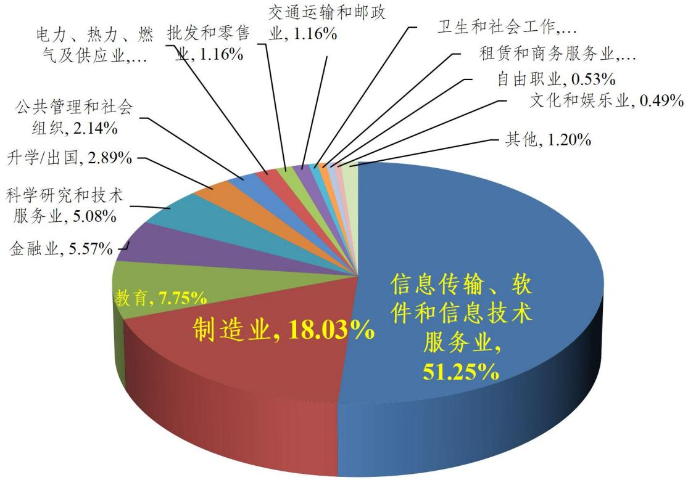

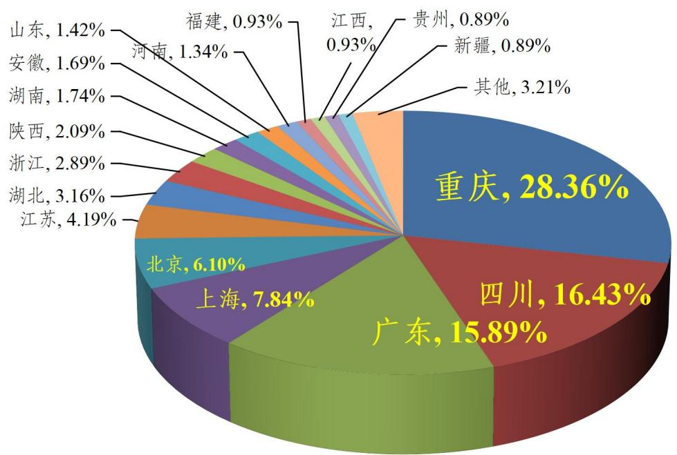  
2025年毕业研究生就业行业分布图

## 研究生风采

## 一、科创赛事结硕果

近年来，学校研究生教育在重庆市高校中发展快速，实力不断增强，人才培养质量进一步提高，为地方经济建设和社会发展作出积极贡献。学校为各类科创活动发展提供支撑交流的平台，以培养研究生科研创新能力和专业技能为重点，通过建立不同学科竞赛目录清单、学科竞赛等级认定标准，为研究生参加创新创业大赛提供了良好的氛围营造和条件保障，积极组织并参与各级各类科创赛事。近几年，研究生获得省部级以上科技奖项合计超过800项，第二十届中国研究生数学建模竞赛优秀组织奖。

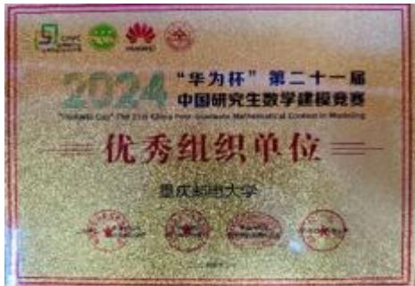  
第二十一届“华为杯”全国研究生数学建模竞赛优秀组织奖

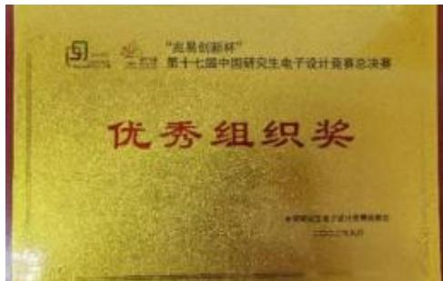  
第十七届中国研究生电子设计竞赛优秀组织奖

## 二、学术氛围呈盛景

## 1． 研究生学术交流

研究生校园文化活动建设紧跟时代进步和行业发展，以“促进思想交流，共图学术进步，提升创新能力，繁荣校园文化”为宗旨，邀请国内外专家、知名校友、行业精英为“研究生数字技术创新创业论坛”“纵横通信”“教授博士论坛”“数学物理进展论坛”等校院学术交流平台开展讲座，通过开展校内外硕博成长交流会、“数说中国”研究生演讲比赛、“ 数字重庆”参观交流实践等形式多样的活动，活跃研究生思维，提高创新能力，在校园内营造良好科研、学习氛围，积极推进科研育人。

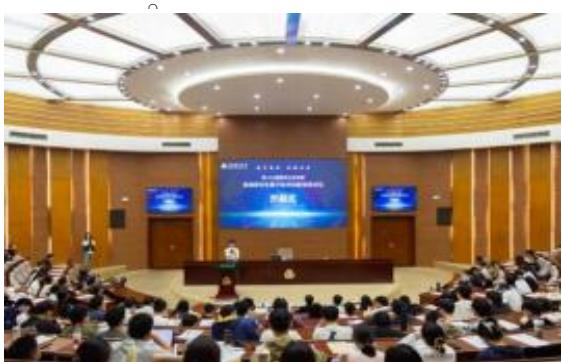  
研究生数字技术创新创业论坛开幕式

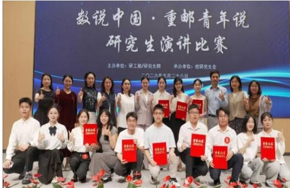  
“数说中国·重邮青年说”研究生演讲比赛

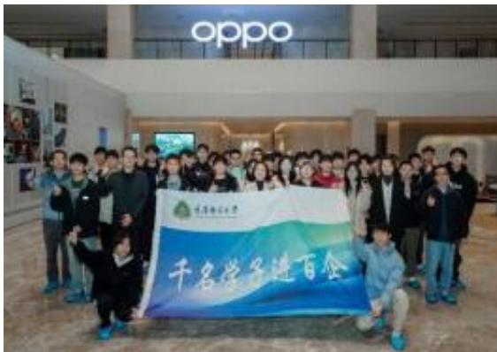  
“数字重庆“参观学习”实践系列活动

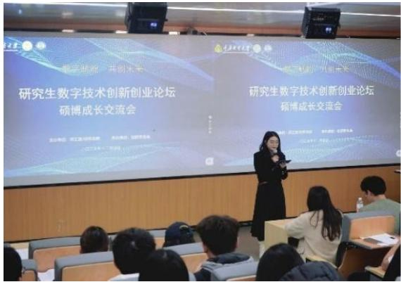  
研究生数字技术创新创业论坛之硕博成长交流会

## 2． 研究生英语风采大赛

为丰富校园文化生活，活跃英语学习氛围，提高我校研究生英语表达能力和演讲能力，更好地给研究生英语爱好者提供一个展现自我及学术交流的舞台。学校每年举办研究生英语风采大赛。2026年举办了“英辞承风骨，数韵筑新程”为主题的英语风采大赛，大赛展现了研究生良好的精神风貌，达到了以赛促学、立德树人的目的。

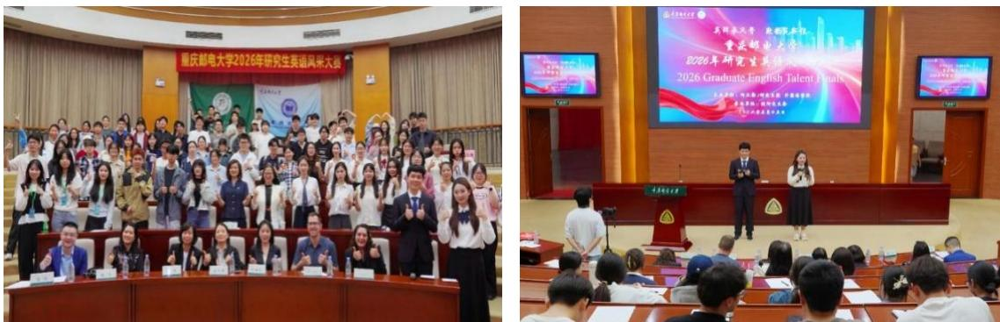  
2026年研究生英语风采大赛

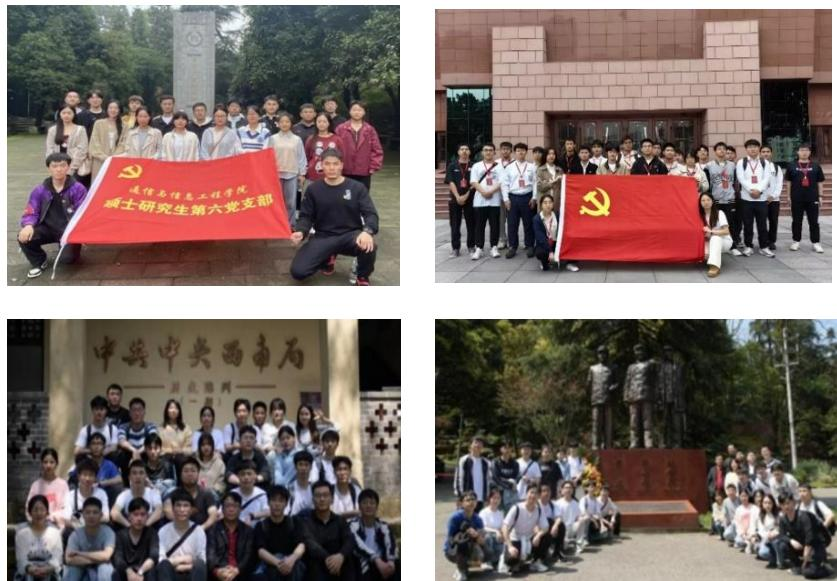  
研究生开展党建活动

## 三、党团建设铸根基

## 1． 研究生党建

坚持抓基层强基础，加强各学院党建工作主体责任，强化政治功能，履行政治责任，落实对研究生党支部工作开展的具体指导。以全国高校“百个研究生样板党支部”和“百名研究生党员标兵”创建培育推进党建工作与研究生导学团队教育管理工作深度融合，全面提升研究生党建工作质量和水平。选优配强研究生党支部书记，实施党务工作能力提升工程。积极探索研究生党支部设置方式，发挥党支部在推动科研创新中的战斗堡垒作用，以党建促科研、以科研助党建，提升党建创新能力，激励带动广大研究生勇于担当、奋发有为，以“志不求易，事不避难”的校风推动学校“ 世界一流学科攀登计划”实施。

## 2． 研究生思想政治教育

深入开展学习贯彻党的二十大和党的二十届历次全会精神，以习近平新时代中国特色社会主义思想为指导，坚持理论武装、凝心铸魂，教育研究生深刻认识“ 两个确立” 的决定性意义，增强“四个意识”、坚定“四个自信”、做到“两个维护”。全面贯彻党的教育方针， 坚持和加强党对高校的全面领导，以“立德树人、服务需求、提高质量、追求卓越”为主线，把思想政治工作贯穿研究生教育和管理工作全过程，坚持立德树人根本任务，立足学校基础和实际，着力破解学校研究生思想政治工作中存在的不平衡不充分问题，构建“大思政”工作格局，大力促进研究生德智体美劳全面发展，更好支撑我校研究生教育综合改革，推进研究生教育内涵式发展，全方位提升我校新时代研究生创新人才培养质量，为党育人、为国育才，增强研究生使命感责任感，培养党和国家事业发展迫切需要的大批德才兼备的高层次人才。

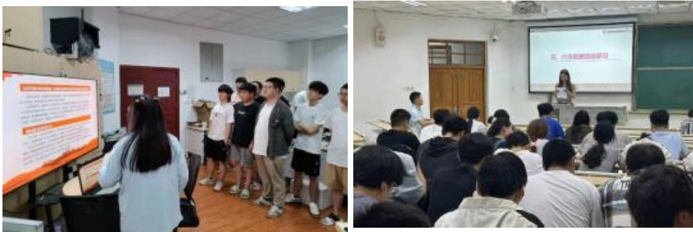  
多措并举开展研究生思想政治教育

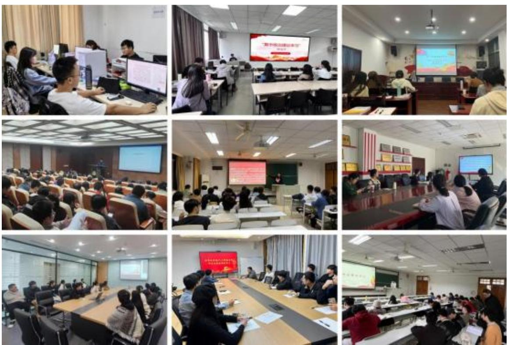  
在研究生中开展政治理论学习活动

## 3． 研究生会

学校加强研究生会组织建设，发挥研究生个人“自我管理、自我服务、自我教育、自我监督”的积极作用，以引导和促进研究生德智体美劳全面发展、健康成长为宗旨，打造丰富多彩的校园文化活动，为全校研究生同学送上最贴心、最周到的服务。成功召开第九次研究生代表大会， 选举产生新一届校研究生会主席团成员。研究生会设立有科技学术部、人力资源部、自律权益部、信息宣传部、文体部、外联部 6 个部门，不断深化自身组织建设，开展新老干部交流会、学生干部素质拓展活动、消防引导员培训大会、关于网络舆情专题培训会、公文写作

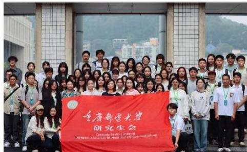  
第八届研究生会成立大会  
重庆邮电大学第十一次学生代表大会暨第九次研究生代表大会合影

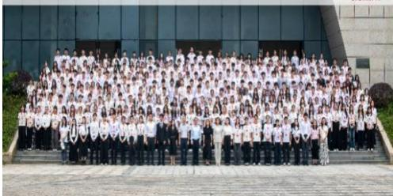  
第九次研究生代表大会

## 四、校园文化绽芳华

## 1． 研究生年度表彰暨迎新晚会

学校每年举办研究生年度表彰暨迎新晚会活动，充分展示了我校研究生积极自信、乐观向上的精神面貌。丰富研究生的校园文化生活，搭建研究生风采展示和沟通交流的平台。

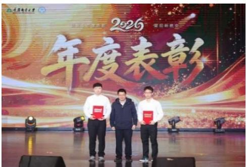

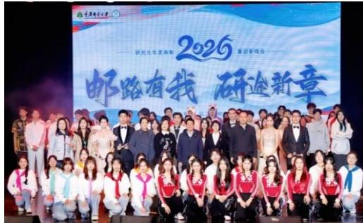  
研究生年度表彰暨迎新晚会

## 2． 研究生运动会风采

我校推进体育运动深入开展，强化体育课和课外锻炼，促进研究生身心健康、体魄强健、全面发展，使研究生运动员们展现出更快、更高、更强的体育精神。在校研究生会组织带领下，研究生代表队获得学校第十九届田径运动会团体总分第三名。

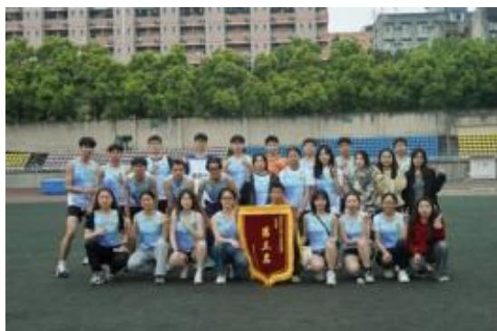  
第十九届学校田径运动会研究生运动员合影

  
第十九届学校田径运动会研究生风采

为深入落实立德树人根本任务，持续深化研究生导学团队建设，大力践行“健康第一”教育理念，强化五育并举，推动研究生身心健康与全面发展，充分激发研究生的创新活力与青春动能，学校每年举办研究生导学团队趣味运动会，真正实现以智趣促融合、以运动育文化。

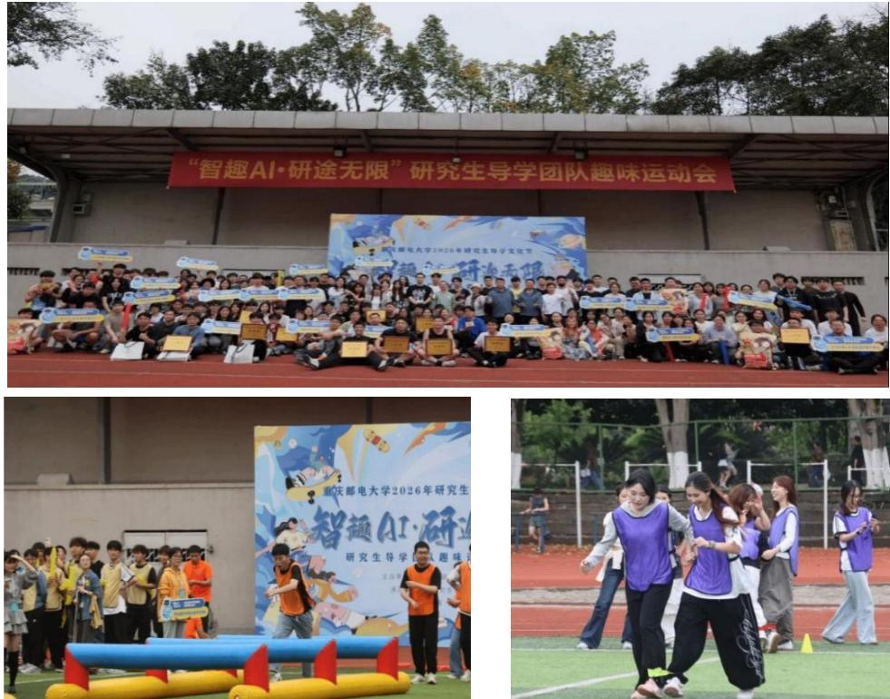  
研究生 2026 年导学团队趣味运动会

## 3． 研究生球队赛事

研究生各球队积极参加篮球赛、排球赛和足球赛等校园运动赛事，研究生篮球队在 2024 年“健康校园”篮球争霸赛中获得三连冠，研究生排球队在学校排球联赛中勇夺男女双冠。充分展示了我校研究生勇于拼搏、积极健康、乐观向上的精神风貌，为营造青春、健康、和谐的校园文化氛围起到了积极的推动作用。

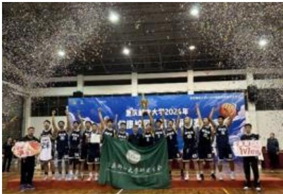  
研究生篮球队喜获三连冠

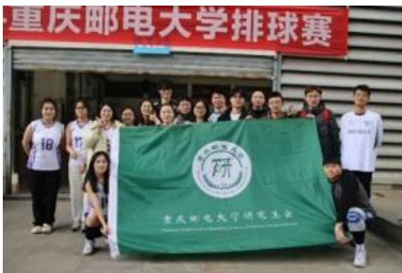  
研究生排球队勇夺男女双冠

## 4． 优秀研究生宣讲团报告会

为贯通建立“本硕博”传帮带育人机制，发挥优秀研究生引领作用，助力研究生导学团队建设，学校成立优秀研究生宣讲团，开展事迹宣讲、经验交流、成长分享等榜样示范带动活动，大力弘扬学校通信报国的红色基因、敢为人先的创新基因和舍我其谁的奉献基因，以实施“世界一流学科攀登计划”为有力引领，激励广大研究生奋发作为、追求卓越，加快成长为党和国家事业发展需要的高素质创新型人才。通过报告会培养研究生严谨认真的治学态度和求真务实的科学精神，激励研究生奋发图强，在学术研究中开展创新性和创造性工作，为推进高水平科技自立自强贡献力量。

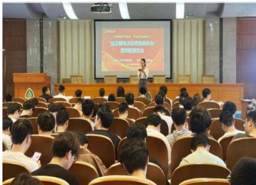  
优秀研究生宣讲团报告会

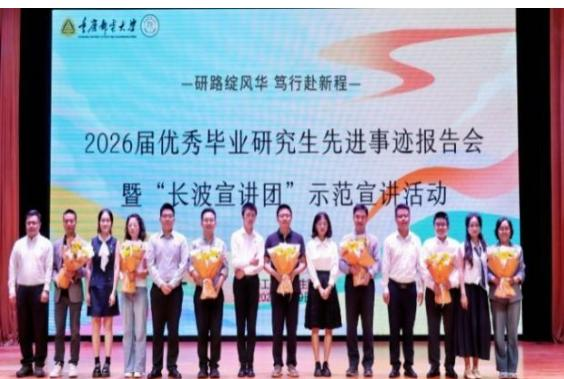  
2026 届优秀毕业研究生先进事迹报告会

## 5． 优秀毕业研究生先进事迹报告会

学校高度重视研究生思想政治教育工作，加强毕业研究生毕业教育，充分发挥优秀研究生的榜样示范和宣传引领作用。坚持每年毕业季举办优秀毕业研究生先进事迹报告会，持续讲好一代代重邮研究生拼搏奋进的动人故事。用优秀毕业研究生的宝贵经验助力全体研究生锚定成长航向，激励广大研究生以先进为榜样，坚定理想信念、厚植家国情怀、锤炼过硬本领、砥砺优秀品格，把奋斗目标转化为内在自觉和外在行动，以“攀登者”的奋进姿态，潜心科研、勇攀高峰，为学校勇攀世界一流学科高峰、全面建设特色鲜明高水平大学作出贡献。

## 硕士研究生招生问答

## 1. 问：学校是否开展推免生、直博生和硕博连读选拔？

答：我校招收推免生、直博生，具体可登录研究生院网站查阅当年的《重庆邮电大学接收优秀应届本科毕业生免试攻读研究生（含直博生）章程》；我校开展硕博连读选拔，具体可查阅我校文件《重庆邮电大学硕博连读实施办法》。

## 2. 问：公布的招生人数中包括推免生吗？接收的推免生人数占招生总人数的比例是多少？是否影响统考生报考？

答：公布的招生人数中包含推免生。2026年我校接收的推免生人数大约占招生总人数的 4.34%（各学科/专业领域接收推免生人数参见当年研究生报考指南《近3年硕士研究生各学院学科/专业领域招生人数统计表》）。

## 3. 问：学校的招生简章在哪里查询？

答：我校研究生招生信息均通过学校研究生院网站（http://yjs.cqupt.edu.cn/）发布，考生可登录我校研究生院网站查阅招生简章和硕士招生版块内容，并请及时关注网站更新的报考年度招生简章。

## 4. 问：什么是同等学力考生？其具备怎样的条件方能报考？

答：同等学力考生是指以下两类考生：

（1）获得国家承认的高职高专毕业学历后满 2年（从毕业后到录取当年入学前）或2年以上人员，按本科毕业同等学力身份报考；（2）国家承认学历的本科结业生，符合招生单位根据本单位的培养目标对考生提出的具体学业要求的，按本科毕业同等学力身份报考。

同等学力考生除上述条件外，我校没有其他限制条件和业务要求。按国家规定，进入复试的同等学力考生，须加试两门与报考学科/专业领域相关的本科主干课程。

## 5. 问：在录取当年入学前可取得国家承认本科毕业证书的自学考试和网络教育本科生能否报考？其具备怎样的条件方能报考？成人教育应届本科毕业生及复试时尚未取得本科毕业证书的自学考试和网络教育考生是否需要加试？

答：在录取当年入学前可取得国家承认本科毕业证书的自学考试和网络教育本科生可以报考硕士研究生，必须凭颁发毕业证书的省级高等教育自学考试办公室或网络教育高校出具的相关证明方完成网上报名、网上确认程序。

成人教育应届本科毕业生及复试时尚未取得本科毕业证书的自学考试和网络教育考生，在复试期间我校不要求加试，但在入学报到时必须取得国家承认的本科毕业证书，否则取消录取资格。

## 6. 问：国家承认学历的应届本科毕业生在录取当年的入学前未取得本科毕业证书是否能入学？

答：不能。国家承认学历的应届本科毕业生在录取当年入学前必须取得国家承认的本科毕业证书，否则录取资格无效。

## 7. 问：具备怎样的条件方能跨专业报考？

答：除具备全国统考生的报考条件外，我校没有其他限制条件。

## 8. 问：非全日制研究生报考条件是什么？

答：按照国家规定，我校非全日制研究生报考条件原则上为在职定向考生。

## 9. 问：网上报名时是否填报导师志愿？

答：网上报名时不填报导师志愿，导师确认工作在拟录取后进行。考生如需了解更多导师信息可以查询我校教师主页（https://faculty.cqupt.edu.cn/）或各学院网站。

## 10. 问：网上报名时如何选择研究方向？是否分研究方向确定复试分数线？

答：我校研究生的研究方向与其导师相关，考生在网上报名时选择其感兴趣的研究方向即可。

我校所有学术学位、专业学位硕士研究生均按学科/专业领域确定复试分数线，且同一学院的同一学科/专业领域的各研究方向复试分数线相同。

## 11. 问：考生是否要到重庆邮电大学参加初试？复试地点在哪里？

答：初试地点一般遵循“ 哪里报名哪里考试”原则，考生按学习或工作地省级 招办的要求选择报考点报名和考试，具体考试地点由考生选择的报考点安排。

研究生招生复试工作一般由研究生招生单位负责组织。正常情况下，我校研究生复试安排在我校校内进行（特殊情况则遵照上级考试管理机构规定执行），具体复试地点、方式、时间将在我校研究生院网站上公布。

## 12. 问：如何查询初试成绩？

答：在重庆市教育考试院规定的时间内，考生可以登录重庆邮电大学研究生院网站（http://yjs.cqupt.edu.cn）查看当年初试成绩查询通知进行查询。

## 13. 问：如何查询复试分数线？近几年各学科/专业领域的复试分数线是多少？

答：在教育部公布当年考生参加复试基本分数要求后，我校根据国家一区线确定各学科/专业领域的复试分数线，考生可以登录我校研究生院网站（http://yjs.cqupt.edu.cn）查阅相关公告。

近3年我校各学科/专业领域的复试分数线参见当年报考指南中的《近3年硕士研究生各学科/专业领域复试最低分数要求》。

## 14. 问：考生如何查看我校的调剂名额？

答：复试期间，考生可登录我校研究生院网站（http://yjs.cqupt.edu.cn）查看各学科/专业领域调剂名额或咨询学校研招办及各招生学院。

## 15. 问：初试报考我校或外校的考生如何申请调剂？

答：若初试报考我校或外校的考生需要申请调剂我校相关学科/专业领域，均须在规定的时间内通过教育部指定的“全国复试调剂服务系统”向我校提出调剂申请。我校如果同意考生调剂申请，将直接通过调剂系统回复复试通知，不再另行通知。具体程序及可接收调剂的学科/专业领域届时可以登录我校研究生院网站（http://yjs.cqupt.edu.cn）查询或直接咨询我校研招办及各学院相关办公室（各学院联系方式参见《研究生招生学院联系方式》）。

## 16. 问：复试的差额比例一般是多少？

答：我校各学科/专业领域复试均为差额复试，差额比例一般不低于120%。生源较好的学科/专业领域可适当扩大复试比例。

## 17. 问：复试包括哪些内容？

答：我校复试包括专业笔试、专业综合面试和外语听说能力测试三个部分。其中，1251工商管理、1253会计、1256工程管理三个专业学位类别的“思想政治理论”科目仅做合格性考核。

同等学力考生复试时须加试与报考学科/专业领域相关的两门本科主干课程。

## 18. 问：初试成绩和复试成绩占录取总成绩的比例是多少？

答：考生初试成绩占录取总成绩的比例（A）不低于50%，复试成绩占录取总成绩的比例（1-A）不高于50%。具体比例在复试前公告。考生录取总成绩为初试成绩和复试成绩按权重相加之和，计算公式为：

$$
\text {录取总成绩} = (\text {初试成绩/初试满分}) \times \mathbf {A} \times \mathbf {1 0 0} + (\text {复试成绩/复试满分}) \times (\mathbf {1 - A}) \times \mathbf {1 0 0} _ {\circ}
$$

具体以当年学校公布的硕士研究生招生复试录取工作办法为准。

## 19. 问：录取原则是什么？一志愿考生在录取时是否享受优惠政策？

答：我校录取工作遵循以下原则：

（1）专业笔试、专业综合面试和外语听说能力测试各单项成绩不合格者，不予录取；（2）同等学力考生加试成绩不合格者，不予录取；（3）思想政治素质和品德考核不合格者，不予录取；（4）体检不合格者，不予录取；（5）以上复试各单项考核合格者，我校坚持“按需招生、全面衡量、择优录取、宁缺毋滥”的原则，按照不同招生学科/专业领域的考生录取总成绩排序择优录取。

我校优先录取一志愿考生：所有第一志愿考生优先复试拟录取，然后再进行调剂考生复试拟录取。

## 20. 问：如何查询复试成绩和拟录取名单？

答：复试结束后，考生在规定的时间内可以登录我校研究生院网站（http://yjs.cqupt.edu.cn）查询本人的复试成绩和拟录取名单。

## 21. 问：如何申请享受初试加分或照顾政策？

答：符合报考当年“全国硕士研究生招生工作管理规定”中的对应条件并申请享受初试加分政策的考生，须在网上报名时按要求填报相关信息。有关部门按职责分工进行审核。

加分项目不累计，同时满足两项以上加分条件的考生按最高项加分。

符合教育部初试加分政策的考生，复试前应按学校当年要求如实填写和提交《重庆邮电大学初试加分申请表》，经审核加分后能达到报考研究方向进入学校复试最低分数线的考生可获得复试资格，学校将予以公布；该学科/专业领域原已公布的复试名单不受此影响。

## 22. 问：体检的安排和标准是什么？

答：考生体检安排在新生入学后进行，由校医院统一组织。体检标准参照教育部、卫生部、中国残联制订的《普通高等学校招生体检工作指导意见》（教学〔2003〕3号）和教育部办公厅、卫生部办公厅《关于普通高等学校招生学生入学身体检查取消乙肝项目检测有关问题的通知》（教学厅〔2010〕2号）执行。具体以学校当年公布的复试录取工作办法为准。

## 23. 问：考生如何进行思想政治素质和品德考核？

答：思想政治素质和品德考核是保证入学新生质量的重要工作环节，主要是考核考生的现实表现，内容包括考生的政治态度、思想表现、道德品质、遵纪守法、诚实守信等方面。我校在复试时将对考生进行思想政治素质和品德考核：所有参加复试的考生登录我校研究生院网站按通知要求下载填写《重庆邮电大学报考攻读硕士学位研究生思想政治素质与品德考核表》，应届毕业生由其本科所在院、系学生工作负责人填写，并加盖院系党组织公章；往届生由档案所在单位或街道办出具并盖章。该表于复试报到时交至对应我校报考学院。

## 24. 问：如何调取人事档案？定向就业考生如何办理相关手续？

答：应届生的人事档案须待其毕业时所有档案材料齐全后一并邮寄，不得分批分次邮寄。往届生须在调档函规定的时间内将其人事档案一次性全部邮寄至我校。按照规定，定向就业考生不调取人事档案。

## 25. 问：定向就业考生如何办理定向培养协议等相关手续？

答：定向就业考生须在正式录取前与我校及其所在单位签订《硕士研究生定向培养协议》。考生因报考、就读我校研究生与其所在单位产生的问题由考生自行处理，若因此造成考生无法录取，责任由考生自负，学校不承担任何责任。定向就业考生若未按时签订定向培养协议，则不予发放录取通知书。

## 26. 问：什么时候发放录取通知书？

答：录取通知书须等教育部下达正式录取名单后方可寄出，时间一般是6月份，每年具体发放时间考生可以登录学校研究生院网站查询。录取通知书以邮政快递（EMS）方式寄出，邮寄地址为考生网报时填写的通信地址。通信地址为重庆邮电大学的，届时考生请自行到重庆邮电大学研招办领取。

## 27. 问：录取考生的导师如何确定？

答：在考生拟录取后，我校将根据考生填报的导师志愿、导师选择意向，并结合各学科/专业领域的招生人数、导师的科研项目经费及已指导研究生情况等综合衡量，确定录取考生的导师。具体情况可咨询招生学院。

## 28. 问：全日制专业学位硕士研究生是否能取得双证？

答：全日制专业学位硕士研究生按照其培养方案进行培养，完成所修学分，通过学位论文答辩，申请授位并通过，可以获得硕士研究生毕业证书和专业硕士学位证书。

## 29. 问：全日制研究生和非全日制研究生的区别？

全日制研究生是指符合国家研究生招生规定，通过研究生入学考试或者国家承认的其他入学方式，被具有实施研究生教育资格的高等学校或其他高等教育机构录取，在基本修业年限或者学校规定年限内，全脱产在校学习的研究生。

非全日制研究生是指符合国家研究生招生规定，通过研究生入学考试或者国家承认的其他入学方式，被具有实施研究生教育资格的高等学校或其他高等教育机构录取，在基本修业年限或者学校规定的修业年限内，在从事其他职业或者社会实践的同时，采取多种方式和灵活时间安排进行非脱产学习的研究生。

## 30. 问：非全日制研究生能享受国家和学校提供的奖助政策吗？在培养期间学校提供住宿吗？

答：根据国家政策，非全日制研究生不享受国家和学校提供的奖助政策，学校在培养期间对非全日制研究生不提供住宿。